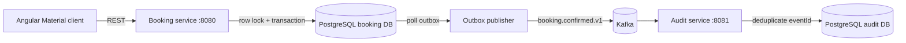

# SeatRush

SeatRush is a full-stack demonstration of safe, concurrent seat booking. Multiple clients can race for the same seat, but a database row lock and unique constraint guarantee that exactly one booking succeeds. The successful transaction also writes a durable outbox event that is published to Kafka and processed idempotently by a separate audit microservice.

## Architecture



### Engineering ideas demonstrated

- **Concurrency control:** `SELECT ... FOR UPDATE` serializes contenders for one seat; a unique booking constraint is the final invariant.
- **Transactional outbox:** the booking and its integration event commit in one local transaction, avoiding a database/Kafka dual write.
- **Idempotent consumer:** the audit service records each event ID once, so at-least-once Kafka delivery is safe.
- **Strategy pattern:** `PricingStrategy` keeps price calculation open for extension without coupling booking orchestration to pricing rules.
- **Rich domain behavior:** `Seat.book()` owns the valid state transition instead of exposing mutable state.
- **SOLID boundaries:** controllers handle transport, application services coordinate use cases, repositories abstract persistence, and messaging adapters own Kafka concerns.

## Stack

- Java 21, Spring Boot 3.5, Spring Data JPA, Flyway, Spring Kafka
- Angular 20, Angular Material, strict TypeScript
- PostgreSQL 17, Apache Kafka 3.9, Docker Compose
- JUnit 5, AssertJ, Mockito, Jasmine/Karma

## Run locally

Prerequisites: Java 21, Docker with Compose, and Node.js 20+.

```bash
docker compose up -d
./mvnw spring-boot:run -pl backend/booking-service
```

In another terminal:

```bash
./mvnw spring-boot:run -pl backend/audit-service
```

Then start the UI:

```bash
cd frontend
npm ci
npm start
```

Open `http://localhost:4200`. The frontend proxies `/api` to the booking service.

## Verify

```bash
./mvnw test
cd frontend
npm test -- --watch=false --browsers=ChromeHeadless
npm run build
```

`BookingConcurrencyTest` releases 20 threads against the same seat and asserts that one booking—and only one—commits.

Useful endpoints:

- `GET /api/shows/11111111-1111-1111-1111-111111111111/seats`
- `POST /api/seats/{seatId}/bookings` with `{"customerEmail":"fan@example.com"}`
- `GET http://localhost:8081/api/audit/bookings`
- `GET http://localhost:8080/actuator/health`

## Deliberate scope

This version keeps authentication, payments, and temporary seat holds outside the core example. Natural next iterations are a time-limited hold state, payment saga with compensating actions, WebSocket inventory updates, OpenTelemetry tracing, and OAuth2/OIDC.
